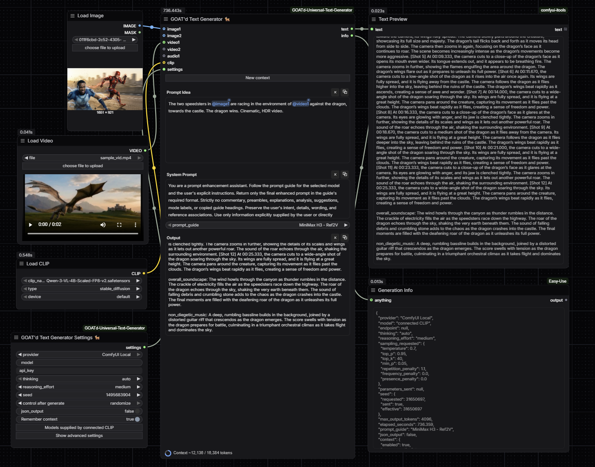
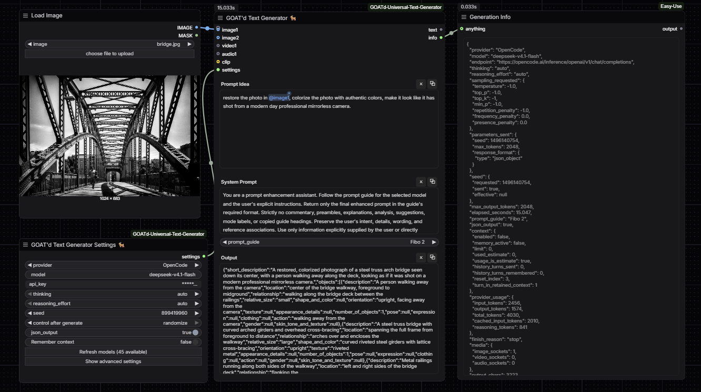
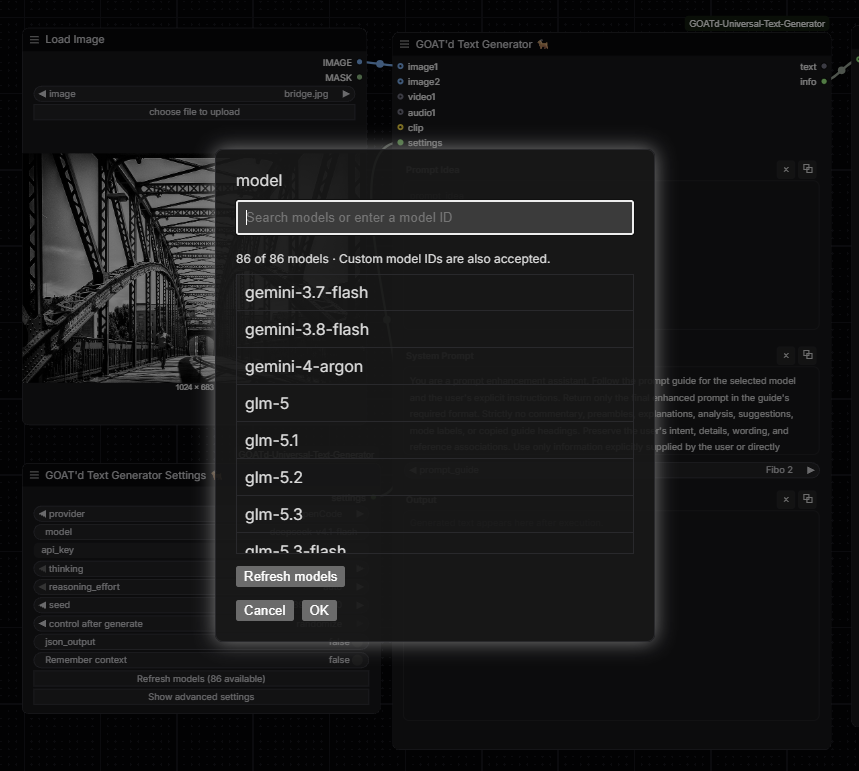
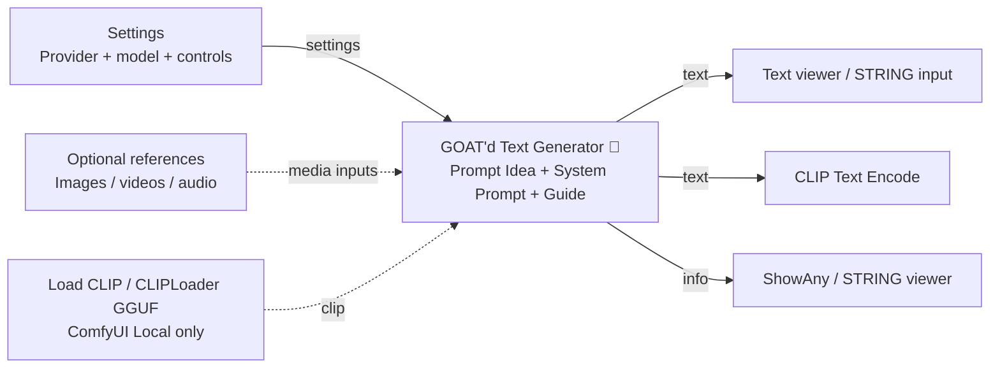

# GOAT'd Text Generator 🐐

Write prompts, captions, descriptions, summaries, and other text inside ComfyUI using a hosted or local LLM. Connect the `text` output to CLIP Text Encode, a text viewer, or any compatible STRING input.

Created by [ninjaGurung](https://github.com/ninjaGurung).

## Features

- Hosted providers, LM Studio, Ollama, and models loaded directly in ComfyUI.
- Separate Settings and Generator nodes, with searchable model lists and custom model IDs.
- Optional image, video, and audio references, with clickable `@` tags.
- Image and video prompt guides, plain-text or structured JSON output.
- Optional conversation memory keeps previous text turns within your token limit, with a usage meter and a **New context** button to start fresh.
- Copy/clear controls, saved output previews, and a generation-info output.

## Local workflow



## API workflow



## Model selection (based on selected provider, requires API key)



## Installation

1. Open a terminal in `ComfyUI/custom_nodes` and run:

   ```bash
   git clone https://github.com/ninjaGurung/ComfyUI-GOATd-Universal-Text-Generator.git
   ```

2. Restart ComfyUI and hard-refresh the browser.
3. Find both nodes under **LLM / GOAT'd**.

Use a recent ComfyUI version with the V3 node API and dynamic-input support. Models, local servers, and optional GGUF loaders are installed separately.

## Upgrade

Inside the installed node folder, run:

```bash
git pull --ff-only
```

Restart ComfyUI and hard-refresh the browser.

## Workflow and examples

1. Connect **GOAT'd Text Generator Settings** to the Generator's `settings` input.
2. Choose a provider and model. For **ComfyUI Local**, connect a generation-capable model to `clip` instead.
3. Write your request in **Prompt Idea**. Set the response style in **System Prompt** and select a guide, or **None**.
4. Connect any references and click **Run**. Read **Output** or send `text` to another node.



For CLIP Text Encode, convert its `text` widget to an input before connecting. The Generator also runs without a downstream viewer.

| Example request | Suggested system instruction |
| --- | --- |
| `A cabin beside a snowy forest at sunset.` | Expand into an image prompt; return only the prompt. |
| `Describe @image1 for a product listing.` | Write a short factual description. |
| `Summarize the action in @video1.` | Return five concise bullet points. |

Import either JSON by dragging it onto the canvas, then select your own models and media:

- [Local workflow](workflows/GOATd_Text_Gen_Local_WF.json): a loaded CLIP model with image and video inputs.
- [API workflow](workflows/GOATd_Text_Gen_API_WF.json): provider settings, an image input, and an Easy-Use **ShowAny** info viewer. Install Easy-Use or remove/replace that viewer.

Screenshots may show additional optional preview nodes.

## Generator fields

| Field | Purpose |
| --- | --- |
| **Prompt Idea** | Your request or text to improve. |
| **System Prompt** | Response instructions: style, language, format, and constraints. |
| **Prompt Guide** | Optional model-specific writing guidance. **None** uses your system instructions alone. |
| **images / videos / audios** | Optional references: up to 10 image, 4 video, and 6 audio sockets. |
| **clip** | A generation-capable model for ComfyUI Local. |
| **settings** | Connection from the Settings node. |
| **Output / text** | Read-only preview and STRING output. |
| **info** | JSON-formatted STRING with provider/model, parameters, timing, token usage when available, media counts, and context information. Connect to ShowAny or a STRING viewer. |
| **New context** | Clears remembered turns, Prompt Idea, and Output; keeps System Prompt and Prompt Guide. Shown when memory is enabled. |

Type `@` in either prompt field to select a connected reference, such as `@image1`. All connected media are sent, including untagged inputs. Remove unused connections; a tag must point to a connected socket.

Media support depends on both provider and model. Video frame mode sends visuals without the soundtrack; native video/audio requires a compatible endpoint and model. ComfyUI Local reads video as sampled frames.

## Settings fields

**Show advanced settings** reveals additional controls; **Hide advanced settings** collapses them. Model lists refresh when provider, credentials, or address changes. Search the list or enter your own model ID.

| Field | Purpose |
| --- | --- |
| **provider / model** | Where generation runs and its model ID. The model field is unused for ComfyUI Local. |
| **api_key** | Provider key. Displayed masked, but saved in workflow JSON. |
| **api_key_env** | Environment-variable name containing the key; available under advanced settings. |
| **base_url** | Provider's default address, or your custom endpoint. |
| **thinking / reasoning_effort** | Reasoning mode and effort, where supported. Some models always reason. |
| **seed / control after generate** | Request repeatable sampling; keep or change the seed after a run. `-1` leaves it unset/random. |
| **json_output** | Default **false**. Enable to request and validate a JSON object. Requires model support. |
| **Remember context / context_window** | Enable text memory at **8192 tokens**, or edit the limit. Disable for **0**; re-enabling restores the last custom limit. |
| **max_output_tokens** | Output budget; reasoning may consume part of it. |
| **temperature** | Lower is more focused; higher is more varied. |
| **top_p / top_k / min_p** | Limit choices by cumulative probability, token count, or relative probability. |
| **repetition_penalty** | Discourage repeated text; **1** is neutral. |
| **frequency_penalty / presence_penalty** | Reduce repeated tokens or encourage new ones. |
| **stop_sequences** | Literal stop text, or a JSON list of stop strings. |
| **timeout_seconds** | API connection/read timeout; increase for slow servers. |
| **force_regenerate** | Request a fresh result instead of reusing an unchanged cached run. |
| **video_mode / video_frame_count** | Choose native video or sampled frames and their count. **auto / 0** uses the default selection. |

Unsupported controls are omitted. Server providers start with sampling defaults (`-1`; frequency/presence penalties `0`). ComfyUI Local starts at temperature **0.7**, top_p **0.95**, top_k **40**, min_p **0.05**, and repetition_penalty **1.1**.

Model, reasoning, credentials, endpoint, and advanced settings are remembered separately per provider while the node is open. Only the current provider's values are saved in the workflow.

The context meter estimates text usage. Older turns are removed as the limit fills; previous media is not retained. Memory clears on restart or after an idle hour. Hosted model limits still apply.

## Prompt guides

Guides help write prompts for a target image/video model; they do not load it or generate media. Choose **None** for general writing. The bundled files are in [prompt_guides](prompt_guides/).

| Guide | Use |
| --- | --- |
| **MiniMax H3** | T2V / FL2V, Ref2V, and Singularity video prompts. |
| **Seedance 2.0 / 2.5**, **Wan 3.0** | Scene, action, camera, reference, and sound instructions. |
| **Fibo 2** | Dev generation/editing and Edit Turbo editing. Plain language by default; VGL JSON when json_output is enabled. |
| **MOSS Image** | Still-image captions, exact visible text, and layout JSON. |
| **Qwen Image 2.1**, **FLUX.2 Klein 9B**, **Krea 2** | Image prompts with composition, appearance, and reference roles. |
| **GPT Image 2.5**, **Nano Banana Pro** | Image generation/editing instructions and text requirements. |

State reference roles explicitly, including first/last frames when needed. For Fibo, keep reference order consistent with the downstream image workflow. MOSS references can inform the caption; they do not enable native image editing.

## Providers

| Provider | Default address | Default key variable |
| --- | --- | --- |
| OpenRouter | `https://openrouter.ai/api/v1` | `OPENROUTER_API_KEY` |
| OpenCode | `https://opencode.ai/inference/openai/v1` | `OPENCODE_API_KEY` |
| Cerebras | `https://api.cerebras.ai/v1` | `CEREBRAS_API_KEY` |
| Groq | `https://api.groq.com/openai/v1` | `GROQ_API_KEY` |
| LM Studio | `http://127.0.0.1:1234` | `LM_STUDIO_API_KEY` |
| Ollama | `http://127.0.0.1:11434` | `OLLAMA_API_KEY` |
| OpenAI-compatible | `https://api.openai.com/v1` or your server | `OPENAI_API_KEY` |
| ComfyUI Local | Connected CLIP model; no server | Not needed |

Enter a key in **api_key**, or create an environment variable before launching ComfyUI and leave **api_key** empty. **api_key_env** can stay blank to use the default variable above. Use environment variables to keep keys out of shared workflows. Prompts and connected media are sent to the selected endpoint.

### LM Studio

Load a compatible chat/vision model and start the local server. Select **LM Studio**, keep the default address unless you changed it, then refresh and choose the model. This preset uses `/api/v1/chat`; older servers can use **OpenAI-compatible** with `http://127.0.0.1:1234/v1`.

### Ollama

Download a model with `ollama pull MODEL_NAME`, replacing `MODEL_NAME` with your chosen model. Start Ollama (`ollama serve` if needed), select **Ollama**, and refresh models. Use a vision model for image references.

### OpenCode

In the [OpenCode Console](https://opencode.ai/console), create a **service account API key** (`oc_sk_...`) with inference access. Use that key in **api_key**, or set `OPENCODE_API_KEY`. Choose **OpenCode** and select an accessible **Chat Completions** model. Other API formats are not supported by this preset; model access and free-tier restrictions depend on your account.

### OpenRouter

Create a key in [OpenRouter Keys](https://openrouter.ai/settings/keys). Select **OpenRouter**, enter that key or set `OPENROUTER_API_KEY`, then refresh models. Use the exact [model ID](https://openrouter.ai/models), including its provider prefix and any `:free` suffix. Check credits, model availability, and rate limits if requests fail.

For **Cerebras**, **Groq**, or another compatible server, select the provider, configure its key/address, and choose a model from its list. Local servers often need no key unless authentication is enabled.

## Tested local models

Tested with **Load CLIP** or **CLIPLoader (GGUF)**, as appropriate:

| Checkpoint | Media notes |
| --- | --- |
| `gemma4_e2b_it_bf16` | Images and sampled video frames. |
| `gemma-4-12B` | Tested checkpoint is text-only. |
| `Qwen3-4B-abliterated-v2_fp8mixed` | Text-only. |
| `Qwen-3-VL-4B-Scaled-FP8-v2` | Images and sampled video frames. |
| `Qwen3-VL-4B-Instruct-abliterated-fp8_scaled` | Images and sampled video frames. |
| `qwen3.5_9b_qwen_image_2.1_pe_i2i.int8_convrot` | Images and sampled video frames. |

Use a complete generation checkpoint and matching loader. Ordinary CLIP/T5 encoders cannot generate answers. Media support depends on the included weights; larger models and context limits need more RAM/VRAM.

## Troubleshooting

| Problem | Try |
| --- | --- |
| Empty or incomplete answer | Increase max_output_tokens or disable thinking if supported. |
| Invalid JSON | Increase the output budget and use a model that follows structured-output instructions. |
| HTTP 400 | Check model, reasoning, sampling, and token settings; use `-1` sampling defaults. |
| HTTP 401 / 403 / 402 | Check key, permissions, model access, and account credit. |
| HTTP 404 / 429 | Check endpoint/model availability or wait for rate limits to reset. |
| Connection error / timeout | Start the server, check base_url, or increase timeout_seconds. |
| Media or generation error | Check the model's capabilities, loader, and attachment tags. |
| Old controls or repeated cached output | Restart ComfyUI, hard-refresh the browser, or enable force_regenerate. |

## License

Copyright © 2026 [ninjaGurung](https://github.com/ninjaGurung). Code is licensed under [GPL-3.0-only](LICENSE). Model weights and third-party material retain their own licenses.
