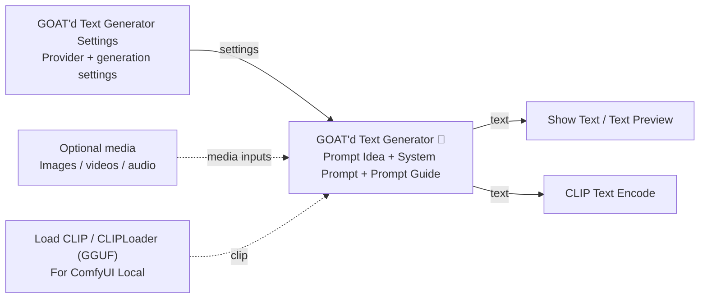
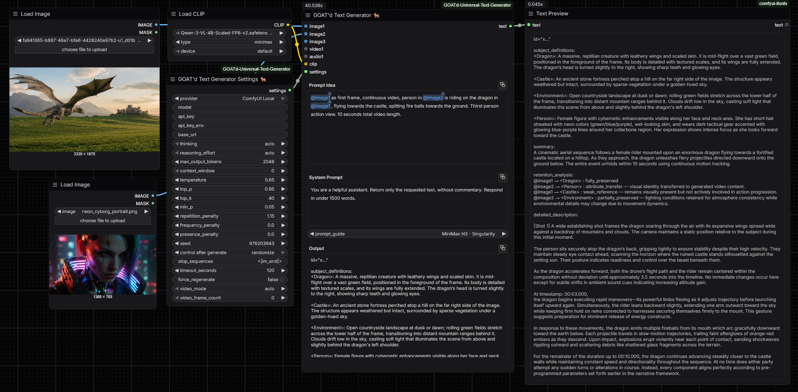
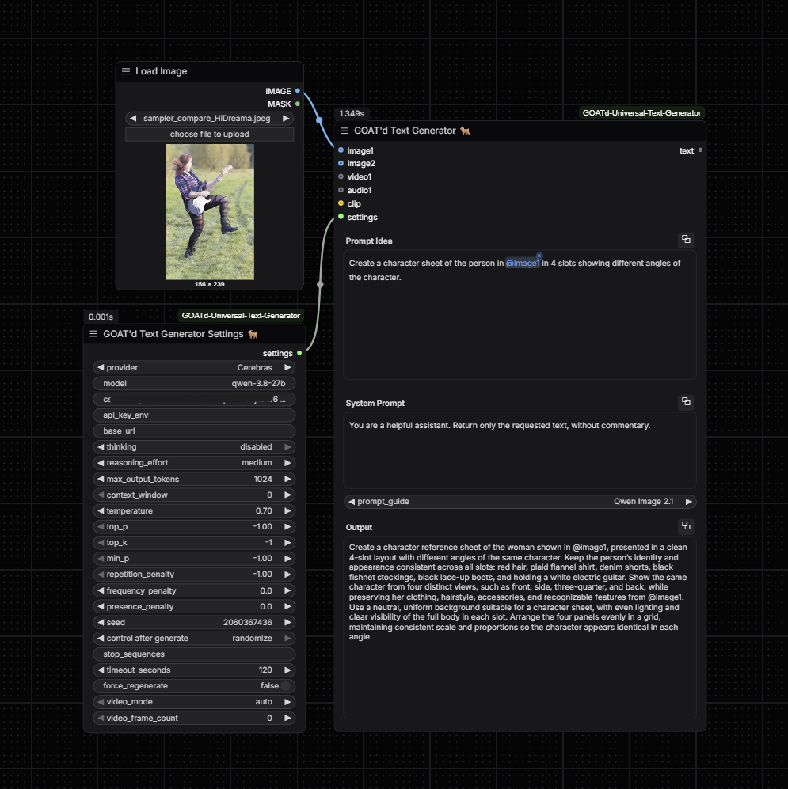

# GOAT'd Text Generator 🐐

**Turn your ideas into prompts, captions, and useful text without leaving ComfyUI.**

**Easy to integrate into your existing ComfyUI workflows:** connect the node's `text` output to CLIP Text Encode, a text preview, or any compatible STRING input.

A ComfyUI custom node for writing prompts, captions, descriptions, and other text with cloud or local LLMs. Add images, videos, or audio when your chosen model supports them. The result is a normal `STRING`, ready for Show Text, CLIP Text Encode, or another text input.

Created by **[ninjaGurung](https://github.com/ninjaGurung)**.

**Example workflows:** [Local CLIP](workflows/GOATd_Local_Text_Gen.json) and [Server API](workflows/GOATd_API_Text_Gen.json).

## Features

- **Cloud and local models:** OpenRouter, Cerebras, Groq, LM Studio, Ollama, OpenAI-compatible servers, and generation-capable models loaded directly in ComfyUI.
- **Two separate nodes:** Keep your writing area clean while managing model settings in a connected Settings node.
- **Prompt guides:** Add model-specific writing instructions to your system prompt.
- **Multimodal inputs:** Dynamic sockets for up to 10 images, 4 videos, and 6 audio inputs. Connecting media reveals another socket; removing it hides extra trailing sockets.
- **Media tags:** Type `@` to suggest connected attachments, or `@im` to filter images. Tags work in both prompt fields.
- **Readable output:** A large, read-only preview and a `text` output that connects to any compatible STRING input. All three text areas scroll independently.
- **Quick copying:** Copy buttons sit beside each text area's title. A checkmark confirms copying for five seconds.
- **Saved previews and caching:** Generated text is restored with saved workflows. Unchanged runs can reuse a cached result; force regeneration when needed.

## Installation

1. Open a terminal in your `ComfyUI/custom_nodes` folder and clone the repository:

   ```bash
   git clone https://github.com/ninjaGurung/ComfyUI-GOATd-Universal-Text-Generator.git
   ```
2. Restart ComfyUI, then hard-refresh your browser.
3. Find both nodes under **LLM / GOAT'd**.

Use a recent ComfyUI version with the V3 node API and dynamic-input support. The node uses ComfyUI's existing `requests` dependency. Model files, local servers, and optional GGUF loaders are not bundled or downloaded automatically.

## Quick start

1. Add **GOAT'd Text Generator Settings 🐐** and **GOAT'd Text Generator 🐐**.
2. Connect the Settings node's `settings` output to the generator's last input.
3. Choose a provider. For a server/API provider, enter its exact model ID and supply a key or environment variable when required. For **ComfyUI Local**, load a generation-capable model with **Load CLIP** or **CLIPLoader (GGUF)**; the Settings model field is ignored.
4. Write your **Prompt Idea**, set the **System Prompt**, and choose a prompt guide or **None**.
5. Optionally connect media. For **ComfyUI Local**, connect a generation-capable model to `clip`.
6. Click **Run**. Read the answer in **Output**, or connect `text` to another node.



Solid arrows show the settings and text connections; dashed arrows show optional inputs. Read the result directly in the generator's **Output**, or connect it to a downstream node.

For **CLIP Text Encode**, convert its `text` widget into an input, then connect the generator's `text` output. The generator also runs without a downstream node.

**Prompt Idea:** `A small cabin beside a snowy forest at sunset.`  
**System Prompt:** `Expand the idea into a detailed image prompt. Return only the prompt.`

## Example workflows

Ready-to-use examples are included in the [workflows](workflows/) folder:

| Workflow | What it demonstrates |
| --- | --- |
| [Local CLIP text generation](workflows/GOATd_Local_Text_Gen.json) | Generate text with a model loaded directly in ComfyUI through the `clip` input. |
| [Server API text generation](workflows/GOATd_API_Text_Gen.json) | Generate text through a provider/server configured in the Settings node. |

Download a workflow JSON and drag it onto the ComfyUI canvas, or open it through ComfyUI's workflow menu. Select your available model and media files; for API workflows, configure the provider, model ID, endpoint, and credentials as needed. Click **Run** to generate text.

### Local CLIP example

**ComfyUI Local** uses a Qwen3-VL checkpoint loaded through **Load CLIP**, with two reference images and generated text connected to **Text Preview**.



### Server API example

**Cerebras** uses an image reference and the **Qwen Image 2.1** prompt guide to generate a character-sheet prompt. Configure your provider and credentials in the Settings node.



## Generator fields

| Field | What it does |
| --- | --- |
| **Prompt Idea** | Your request, rough concept, or text to improve. This is the larger editable text area. |
| **System Prompt** | Instructions for how the LLM should answer: style, format, language, or constraints. |
| **Prompt Guide** | Adds the selected guide to your system prompt. **None** leaves the system prompt unchanged. |
| **Images** | Optional `IMAGE` inputs, tagged `@image1` through `@image10`. A socket may contain an image batch. |
| **Videos** | Optional `VIDEO` inputs, tagged `@video1` through `@video4`. Use a VIDEO loader; an IMAGE frame batch needs conversion first. |
| **Audios** | Optional `AUDIO` inputs, tagged `@audio1` through `@audio6`. Requires an audio-capable provider and model. |
| **clip** | Optional ComfyUI model connection used by **ComfyUI Local**. This is the second-last input. |
| **settings** | Required connection from **GOAT'd Text Generator Settings 🐐**. This is the last input. |
| **Output / text** | The final answer: a read-only preview and one `STRING` output. Results never overwrite your prompt fields. |

### Media tags

```text
Compare @image1 with @image2 and describe the action in @video1.
```

Type `@` inside either prompt area to see available connected tags. Select with a click, or use Arrow keys and Enter/Tab. Escape closes suggestions. Inserting a tag preserves the surrounding text. Tags appear as colored references: click a tag to choose a replacement, or click its `×` to remove that reference from the prompt. Removing a tag does not disconnect its media input.

All connected media are sent, even when they are not tagged. Repeated tags do not resend an attachment. A tag pointing to an unconnected socket raises an error.

## Prompt guides

The dropdown shows **📁 MiniMax H3**, **📁 Seedance**, **None**, then the remaining guides alphabetically. **None** is the default.

| Guide | What it helps write |
| --- | --- |
| **📁 MiniMax H3 → T2V / FL2V** | Text-to-video and first/last-frame video prompts. |
| **📁 MiniMax H3 → Ref2V** | Prompts using supplied visual references. Includes the T2V guide it depends on. |
| **📁 MiniMax H3 → Singularity** | Prompts following the supplied Singularity guide. |
| **📁 Seedance → 2.0 / 2.5** | Scene, action, camera, reference, and sound descriptions. |
| **FLUX.2 Klein 9B** | Clear image prompts describing subjects, composition, and appearance. |
| **GPT Image 2.5** | Image generation/editing prompts with clear visual details and exact requested text. |
| **Krea 2** | Image prompts with subject, style, lighting, and composition. |
| **Nano Banana Pro** | Image creation/editing prompts with reference roles and clear constraints. |
| **Qwen Image 2.1** | Image prompts with layout, visual details, and text requirements. |
| **Wan 3.0** | Video prompts describing action, camera movement, references, and sound. |

Guides describe the **image/video model you are writing for**, not the LLM generating the text. They do not load those models or generate images/videos. Guides are bundled locally; selecting one makes no extra web request. Explicit user details take precedence over guide examples.

MiniMax H3, Qwen Image 2.1, Wan 3.0, Seedance 2.0 / 2.5, FLUX.2 Klein 9B, and Krea 2 load the full supplied Markdown documents from `prompt_guides/`. The remaining summaries draw on [GPT Image](https://developers.openai.com/api/docs/guides/image-prompting) and [Nano Banana Pro](https://blog.google/products-and-platforms/products/gemini/prompting-tips-nano-banana-pro/).

## Settings fields

Settings only take effect where the selected provider and model support them. Unsupported provider-specific fields are omitted. For sampling fields, **-1 uses provider/native defaults**.

| Field | Default | Simple explanation |
| --- | --- | --- |
| **provider** | OpenRouter | Where the LLM runs. Choose a cloud service, local server, or ComfyUI Local. |
| **model** | Empty | Exact model ID from the selected provider/server. Ignored for ComfyUI Local. |
| **api_key** | Empty | Your provider's API key. Overrides the environment-variable value. Local servers usually need no key. |
| **api_key_env** | Empty | Name of an environment variable containing the key. Empty uses the provider's default variable below. |
| **base_url** | Empty | Custom server/API address. Empty uses the provider default. Required for OpenAI-compatible servers. Full endpoint URLs also work. |
| **thinking** | auto | Use the model's default reasoning behavior, enable it, or disable it when supported. |
| **reasoning_effort** | auto | Request low, medium, or high reasoning effort when thinking is enabled. Support varies by model. |
| **max_output_tokens** | 1024 | Maximum generation budget. Reasoning may use part of this budget. |
| **context_window** | 0 | Context size for LM Studio/Ollama. **0** uses the server default. Hosted and ComfyUI Local context limits are managed elsewhere. |
| **temperature** | 0.7 | Higher gives more varied results; lower is more focused. **0** uses greedy decoding locally. |
| **top_p** | -1 | Samples from the smallest token pool reaching this probability. Lower values narrow the choices. |
| **top_k** | -1 | Limits sampling to the most likely K tokens. Used by OpenRouter, LM Studio, Ollama, and ComfyUI Local. |
| **min_p** | -1 | Filters out tokens that are unlikely relative to the best token. Same provider support as top_k. |
| **repetition_penalty** | -1 | Discourages repeated text. **1** is neutral; higher values discourage repetition. Same provider support as top_k. |
| **frequency_penalty** | 0 | Positive values discourage frequently repeated tokens. Used by OpenRouter, Cerebras, and OpenAI-compatible servers. |
| **presence_penalty** | 0 | Positive values encourage new topics/tokens. Used by OpenRouter, Cerebras, OpenAI-compatible servers, and ComfyUI Local. |
| **seed** | -1 | A nonnegative value requests repeatable sampling where supported. **-1** leaves it unset remotely or chooses a random local seed. Not exposed by LM Studio's native API. |
| **control after generate** | Frontend-managed | If shown beside seed, keep it fixed or change it after a run. This is a ComfyUI seed-widget control, not an API parameter. |
| **stop_sequences** | Empty | Stop text: enter a literal such as `</s>` or a JSON list such as `["</s>", "\nUser:"]`. Newline-separated lists also work. |
| **timeout_seconds** | 120 | Connection/read timeout for API requests. Increase it for slow local servers. Does not limit native ComfyUI generation. |
| **force_regenerate** | false | **true** requests a new result every execution. **false** allows unchanged runs to use ComfyUI's cache. |
| **video_mode** | auto | **auto** chooses native video or sampled frames by provider; **native** sends video; **frames** sends timestamped images. |
| **video_frame_count** | 0 | Frames per video in frame mode. **0** selects 2 for Cerebras/Groq and 12 for other paths. A positive value sets the count. |

Some reasoning models reject custom temperature/top_p; use **-1** for their defaults. Some models always reason and cannot disable thinking. LM Studio's native API does not expose stop sequences. ComfyUI Local trims stop text after generation, so stops do not reduce its generated-token work. Reasoning effort and frequency penalty are not native ComfyUI generation controls.

## Providers and API keys

| Provider | Default address | Default key environment variable |
| --- | --- | --- |
| OpenRouter | `https://openrouter.ai/api/v1` | `OPENROUTER_API_KEY` |
| Cerebras | `https://api.cerebras.ai/v1` | `CEREBRAS_API_KEY` |
| Groq | `https://api.groq.com/openai/v1` | `GROQ_API_KEY` |
| LM Studio | `http://127.0.0.1:1234` | `LM_STUDIO_API_KEY` |
| Ollama | `http://127.0.0.1:11434` | `OLLAMA_API_KEY` |
| OpenAI-compatible | Your server's API prefix, e.g. `http://localhost:8080/v1` | `OPENAI_API_KEY` |
| ComfyUI Local | Connected `clip` model; no server | Not used |

Start LM Studio/Ollama and make your model available before running. LM Studio uses its native `/api/v1/chat` endpoint; older installations can use OpenAI-compatible with `http://127.0.0.1:1234/v1`. Ollama uses `/api/chat`.

Use your provider's exact model ID. For GPT-OSS, Cerebras uses `gpt-oss-120b`; Groq uses `openai/gpt-oss-120b`. GPT-OSS is a text model and always reasons: use **auto** or **enabled**.

**Key privacy:** Direct API keys are saved in ComfyUI workflows/history. Use environment variables when sharing workflows. The node sends your prompt and connected media to the selected endpoint. It adds no telemetry, background discovery, model downloads, or automatic request retries. Changing an environment key alone does not clear cached output; enable force_regenerate when needed.

## Image, video, and audio support

The provider **and** chosen model must support your media. A chat-compatible endpoint is not automatically multimodal.

| Provider | Images | Video | Audio inputs |
| --- | --- | --- | --- |
| OpenRouter | Yes, with a vision model | Native video or sampled frames | Yes, with an audio model |
| Cerebras | With a vision model | Sampled frames | No |
| Groq | With a vision model | Sampled frames | No |
| LM Studio | With a vision model | Sampled frames | No on this node's API path |
| Ollama | With a vision model | Sampled frames | No on this node's API path |
| OpenAI-compatible | Endpoint/model-dependent | Native video or sampled frames | Endpoint/model-dependent |
| ComfyUI Local | Checkpoint-dependent | Sampled frames | Requires a supported native audio-capable checkpoint |

Frame mode sends visuals **without the soundtrack**. Native video sends the soundtrack when present. For ComfyUI Local, use auto or frames; native video is unsupported. Its supported Gemma audio path accepts up to 30 seconds of combined audio.

Provider limits may be lower than the node's socket counts. Image batches and sampled video frames count as images, too. The node does not silently remove supplied media to fit provider limits. Large media/context settings also use more RAM/VRAM.

## Local models through the CLIP input

Select **ComfyUI Local** in Settings and connect your loaded model to `clip`. The model ID, API-key, and URL fields are not needed on this path. ComfyUI handles loading and memory.

The CLIP input needs a complete language model that can generate text. Ordinary text and vision encoders cannot produce an answer on their own.

| Local model | Images | Videos |
| --- | --- | --- |
| `gemma4_e2b_it_bf16` | Yes | Yes, as sampled frames |
| `gemma-4-12B` | Requires a vision-enabled checkpoint | Requires a vision-enabled checkpoint; sampled frames |
| `Qwen3-4B-abliterated-v2_fp8mixed` | No; text-only | No; text-only |
| `Qwen-3-VL-4B-Scaled-FP8-v2` | Yes | Yes, as sampled frames |
| `Qwen3-VL-4B-Instruct-abliterated-fp8_scaled` | Yes | Yes, as sampled frames |
| `qwen3.5_9b_qwen_image_2.1_pe_i2i.int8_convrot` | Yes | Yes, as sampled frames |

The image-capable checkpoints listed above include vision weights. The Gemma 12B checkpoint used for text-generation testing is text-only; image/video use needs a vision-enabled checkpoint and a loader that supports it. Local video analysis uses timestamped frames, without the video's soundtrack.

These models have been tested using **Load CLIP** for Safetensors files and **CLIPLoader (GGUF)** for GGUF files. Media support depends on the checkpoint. Larger models and longer prompts need more RAM/VRAM.

## Troubleshooting

| Issue | Try this |
| --- | --- |
| Blank answer / no final answer | Increase max_output_tokens or disable thinking if the model supports it. Reasoning can consume the budget. |
| HTTP 400 | Check model ID, thinking mode, sampling controls, and token limits. |
| HTTP 401 / 403 | Check your key, permissions, and model access. |
| HTTP 402 | Check provider credits/billing and the selected model's access requirements. |
| HTTP 404 | Check base_url and model ID. |
| HTTP 429 | Check rate limits/quota and wait before retrying. |
| Connection error / timeout | Start your local server, check its address, or increase timeout_seconds. |
| Model cannot generate or read media | Choose a complete generation checkpoint and a compatible loader/provider. |
| Old layout or stale output | Restart ComfyUI, hard-refresh the browser, or enable force_regenerate for a fresh answer. |

## License

Copyright © 2026 [ninjaGurung](https://github.com/ninjaGurung).

This project's code is licensed under the **GNU General Public License v3.0 (GPL-3.0-only)**. See [LICENSE](LICENSE) for the full terms. Model weights and third-party material retain their own licenses.
